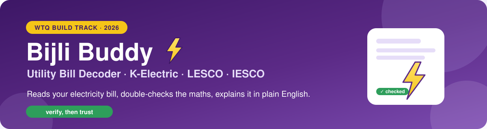

<p align="center">
  
</p>

<p align="center">
  
  
  
  
</p>

<p align="center">
  <b>An AI assistant that reads a Pakistani electricity bill, pulls out every charge and tax,<br>
  and explains it in plain English, without making numbers up.</b>
</p>

---

## 💜 What it does

| | |
|---|---|
| 📄 **Reads any bill** | K-Electric, LESCO (both layouts) and IESCO bills: clean scans, screenshots, tilted or folded phone photos, partly in Urdu |
| 🧾 **Extracts** | One structured JSON per bill: tariff, readings, every charge and tax line, arrears, due dates and late-payment amounts |
| 💬 **Explains** | Answers customer questions in plain English, such as *"How much of my bill is taxes?"* or *"Am I using more than last summer?"* |
| ✅ **Checks itself** | Every total is cross-checked against the bill's own arithmetic, and every number in an answer is traced back to the bill |

## 💛 The idea: verify, then trust

Small, low-cost models are fast and cheap, but they misread digits and slip on arithmetic. Instead of using a bigger
model, **Bijli Buddy makes the system check its own work**:

- **The AI reads; code does the maths.** Gemini handles vision, layout, Urdu and language. Python handles every
  calculation, conversion and check.
- **Two readings and a referee.** Each bill is read twice (original image, then enhanced and zoomed views). A second
  model re-reads only the fields where the two readings disagree.
- **The bill's own maths is the test.** Charges + taxes = bill, and bill + arrears = payable. If a total doesn't
  add up, the model re-reads just those values. This caught a printed **8** hidden under a fold that every reading
  had seen as a **3**.
- **No invented values.** Anything blank, greyed out or unreadable becomes `null`. Answers can only use numbers
  that trace back to the bill.

## 💚 How it works

```mermaid
flowchart LR
    A([📷 Bill image]):::white --> B[Preprocess<br/>rotate · deskew · sharpen · zoom]:::lav
    B --> C[Read A<br/>original image]:::purple
    B --> D[Read B<br/>enhanced + zoomed]:::purple
    C --> E{Readings<br/>agree?}:::yellow
    D --> E
    E -- no --> F[Referee model<br/>re-reads disputed fields]:::purple
    E -- yes --> G[Arithmetic<br/>cross-checks]:::green
    F --> G
    G -- a total fails --> H[Targeted re-read<br/>of those values]:::purple
    H --> G
    G -- all pass --> I[Normalise<br/>dates · CR credits · types]:::lav
    I --> J([🧾 Level 1 JSON]):::white

    J --> K[Fact sheet<br/>history · tiers · notes]:::lav
    K --> L[AI plans<br/>the calculation]:::purple
    L --> M[Python computes<br/>safe calculator]:::green
    M --> N[AI writes<br/>plain-English answer]:::purple
    N --> O{Every number<br/>on the bill?}:::yellow
    O -- no --> N
    O -- yes --> P([💬 Answer]):::white

    classDef purple fill:#5B2A86,stroke:#3D1766,color:#FFFFFF;
    classDef lav fill:#E6DDF8,stroke:#B9A5E8,color:#3D1766;
    classDef yellow fill:#F5C518,stroke:#C99A00,color:#3D1766;
    classDef green fill:#2E9E5B,stroke:#1F7442,color:#FFFFFF;
    classDef white fill:#FFFFFF,stroke:#B9A5E8,color:#3D1766;
```



<details>
<summary><b>Technical details of the pipeline</b></summary>

**Extraction (Level 1)**
- Preprocessing: EXIF rotation, Hough-line deskew, CLAHE contrast, upscaling and zoomed top/bottom crops.
- Gemini output is constrained by a JSON schema, with provider-specific layout hints (KE, IESCO, and LESCO's
  summary and itemised layouts).
- Readings are compared field by field. Where they disagree, a different allowed model acts as the referee.
- Arithmetic checks choose between competing readings and never overwrite them:
  `prev + units = current` · `Σ charges ≈ subtotal` · `Σ taxes ≈ subtotal` · `charges + taxes ≈ current bill` ·
  `current + arrears (+ FPA) ≈ payable` · `late ≥ on-time` · date order.
- If a sum check still fails, the model re-reads only the values involved and is told not to compute them. Then
  *confusable-digit repair* runs: if changing **one** easily confused digit (3↔8, 1↔7, 5↔6 …) in one printed total
  makes every check pass, that reading is used and recorded in the audit file.
- A deterministic normaliser handles ISO dates, `CR` → negative, subsidies as negative, dropping 0-lines, the
  highest late-payment amount, exact field order and removing personal identifiers.

**Answers (Level 2)**
- Fact sheet: extracted fields, the 12-month history, late-payment tiers, printed percentages, translated Urdu
  notes and pre-computed metrics.
- **Plan → compute → write → verify.** The AI writes calculator expressions, a safe AST evaluator runs them (no
  `eval`), the AI writes the answer, and a verifier checks that every number and month name appears in the facts.
  Otherwise it makes one targeted repair call.

**Robustness**
- About 2–3 vision calls per bill plus 2 text calls for all questions.
- Disk cache, rate limiting (the free tier allows 15 requests/min), exponential backoff, automatic fallback to the
  second model, and a schema-valid fallback row if a bill can't be read.

</details>

## ✨ Bijli Buddy UI

A friendly Streamlit app with:
- a one-line summary of what you owe and when
- a **trust meter** with a pill for each maths check
- a "your bill in plain words" summary and tips
- a chat with suggested questions and a "how I worked it out" panel
- a usage-history chart and a where-the-money-goes chart
- the extracted JSON with a download button

```bash
pip install -r requirements-demo.txt
python -m streamlit run app.py
```

> Use `python -m streamlit` (not the bare `streamlit` command) so the UI runs in the same Python environment where
> `requirements.txt` was installed. Otherwise you may see `cannot import name 'genai' from 'google'`.

## 🚀 Quick start

**Runtime:** Python 3.13 (tested on 3.13.2; 3.11+ works)

```bash
git clone https://github.com/sana200420/utility-bill-decoder-WTQ.git
cd utility-bill-decoder-WTQ
python -m venv .venv
# Windows: .venv\Scripts\activate    macOS/Linux: source .venv/bin/activate
pip install -r requirements.txt
cp .env.example .env        # then put your Gemini API key in API_KEY
```

Get a free Gemini key at [aistudio.google.com](https://aistudio.google.com) ("Get API key").

**One bill, with questions:**

```bash
python run.py bill path/to/KESC_0008.png -q "How much of my bill is taxes?"
```

**A whole folder** (fills the competition's CSV templates, then validates them):

```bash
python run.py batch --bills path/to/bills --level1 path/to/level1.csv --level2 path/to/level2.csv --out output
python check_outputs.py --templates path/to/csv --out output
```

Bills are matched to CSV rows by file name (`KESC_0002` → `bills/KESC_0002.png|.jpg`). Each run also writes an
audit file per bill to `../audit/` (or the folder given with `--audit`), recording the checks, votes, disagreements
and any repairs.

**Offline tests** (no API calls):

```bash
python -m unittest discover -s tests
```

## 🗂️ Project layout

| Path | Purpose |
|---|---|
| `run.py` | CLI: `batch` (fills both CSV templates) and `bill` (one bill plus questions) |
| `app.py` | Bijli Buddy Streamlit UI |
| `billdecoder/preprocess.py` | orientation, deskew, enhancement, zoom crops |
| `billdecoder/prompts.py` | JSON schema, extraction rules, KE/LESCO/IESCO layout hints |
| `billdecoder/extract.py` | multi-pass extraction, voting, referee, check-guided arbitration, re-reads |
| `billdecoder/validate.py` | arithmetic cross-checks and confusable-digit repair |
| `billdecoder/normalize.py` | deterministic conversion to the JSON contract |
| `billdecoder/facts.py`, `calc.py`, `answer.py` | fact sheet, safe calculator, plan → compute → write → verify |
| `billdecoder/explain.py` | plain-language bill summary (numbers verified the same way) |
| `billdecoder/llm.py` | Gemini client: schema output, cache, throttling, retries, fallback |
| `check_outputs.py` | validates generated CSVs against the templates and the JSON contract |
| `package.py` | builds the submission ZIP and refuses to include secrets |
| `tests/` | offline unit tests |

## ⚙️ Environment variables

| Variable | Value used |
|---|---|
| `MODEL_PROVIDER` | `google` |
| `MODEL_NAME` | `gemini-3.5-flash-lite` (primary) |
| `FALLBACK_MODEL_NAME` | `gemini-3.1-flash-lite` (referee and fallback) |
| `API_KEY` | your Gemini key (placeholder in `.env.example`) |
| `REQUEST_TIMEOUT_S`, `MIN_REQUEST_INTERVAL_S`, `MAX_RETRIES`, `CACHE_DIR` | optional tuning |

The code refuses to run with any model outside the competition's allowed list.

## 🤖 AI usage

| Category | Used |
|---|---|
| **Models** | Gemini 3.5 Flash-Lite (`gemini-3.5-flash-lite`) as the main model for reading bills, planning and writing answers, repairs and the UI summary. Gemini 3.1 Flash-Lite (`gemini-3.1-flash-lite`) as the referee for disputed fields and fallback when the main model is unavailable. |
| **APIs** | Google Gemini API (Google AI Studio) via the `google-genai` Python SDK |
| **Services** | none (no OCR or invoice-extraction services, no Azure, Textract or Mindee) |
| **Local OCR libraries** | none (OpenCV and Pillow are used only for image preprocessing) |
| **AI tools used to write the code** | Claude Code (Anthropic) as a coding assistant |

---

<p align="center">
  <sub>Built in one day for the <b>Women Tech Quest (WTQ) Build Track 2026</b> 💜💛💚</sub>
</p>
